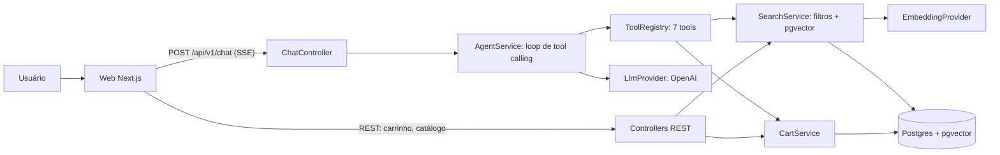

# Garfo

**Assistente de pedidos com IA:** você descreve o que quer comer em linguagem natural e um agente com tool calling busca pratos reais no banco, recomenda e monta o carrinho.

[](https://github.com/oriajsan/Garfo-AI/actions/workflows/ci.yml)
[](LICENSE)

- **Demo:** <https://SEU-DEPLOY.vercel.app> <!-- TODO(owner): trocar pela URL real da Vercel depois do deploy -->
- **Como funciona (para recrutadores):** <https://SEU-DEPLOY.vercel.app/como-funciona> <!-- TODO(owner): mesma URL da demo + /como-funciona -->

<!-- TODO(owner): gravar o GIF conforme docs/gif-script.md -->


> Projeto de portfólio, inspirado em apps de delivery. Restaurantes e pratos são fictícios e nenhum pagamento é real.

## O que ele faz

1. **Entende pedidos em português:** "algo vegetariano, sem lactose, até R$ 40, que chegue em 30 min" vira uma busca com filtros estruturados.
2. **Busca pratos reais, nunca inventados:** busca híbrida em Postgres com pgvector (filtros SQL + similaridade semântica) sobre 6 restaurantes e 80 pratos.
3. **Recomenda e monta o carrinho:** até 3 opções em cards, adiciona ao carrinho quando você pede e avisa quando há conflito de restaurante.
4. **Deixa a decisão final com você:** o checkout é um botão simulado, fora do alcance do modelo (veja o [ADR 005](docs/adr/005-checkout-fora-das-tools.md)).

## Arquitetura



**Fluxo de uma mensagem**

1. O front envia `{ message, conversationId? }` com o header `X-Session-Id` (sessão anônima, sem login).
2. O `AgentService` carrega o histórico da conversa e chama o LLM com o system prompt e as definições das tools.
3. Se o LLM pedir tools, o `ToolRegistry` valida os argumentos com Zod, executa e devolve o resultado ao LLM. Repete até a resposta final ou o limite de 6 iterações.
4. Cada etapa é emitida ao front como evento SSE: texto, tool em execução, cards de pratos e carrinho atualizado.
5. A conversa e as mensagens são persistidas ao final.

Uma versão ilustrada, com as 7 tools e as defesas contra alucinação, está em `/como-funciona`.

## Decisões técnicas

Cada decisão importante tem um ADR curto (contexto, decisão, alternativas e consequências):

- [ADR 001: monorepo com pnpm](docs/adr/001-monorepo-com-pnpm.md): API, web e contratos Zod compartilhados mudam juntos, num só PR.
- [ADR 002: pgvector em vez de banco vetorial dedicado](docs/adr/002-pgvector-em-vez-de-banco-vetorial-dedicado.md): filtros obrigatórios e similaridade na mesma consulta SQL.
- [ADR 003: loop de agente próprio, sem framework](docs/adr/003-loop-de-agente-proprio-sem-framework.md): um `for` limitado a 6 iterações mostra que o mecanismo é entendido.
- [ADR 004: SSE sobre POST, consumido com fetch](docs/adr/004-sse-via-post-com-fetch.md): `EventSource` não aceita POST, então o streaming usa `fetch` + `ReadableStream`.
- [ADR 005: checkout fora das tools](docs/adr/005-checkout-fora-das-tools.md): ações irreversíveis ficam com o usuário, não com um modelo probabilístico.
- [ADR 006: provedor compatível com OpenAI via `OPENAI_BASE_URL`](docs/adr/006-provedor-compativel-com-openai-via-base-url.md): o mesmo SDK atende OpenAI e Gemini, com schemas portáveis e validação de dimensões.

Outras decisões de detalhe estão em [`docs/decisions-log.md`](docs/decisions-log.md).

## Qualidade

- **Testes automatizados** (Jest, sem chamar o LLM real): regras do carrinho, schemas das tools, parser de marcadores, loop do agente com provedor falso, busca contra Postgres real e fluxos HTTP (Supertest). Rodam no CI a cada PR.
- **Avaliação do agente** (`pnpm eval`, manual, com a chave real): 20 casos com expectativas verificadas por código, sem LLM como juiz. Cobre filtros simples, restrições e alergias, carrinho em várias mensagens, conflito de restaurante, buscas sem resultado, assuntos fora do escopo e prompt injection.

| Métrica                          | Resultado                                               |
| -------------------------------- | ------------------------------------------------------- |
| Taxa de acerto                   | 90% (18 de 20)                                          |
| Latência por resposta (p50, p95) | 7.372 ms, 27.505 ms                                     |
| Custo por conversa de teste      | US$ 0 (plano gratuito do Gemini)                        |
| Modelo avaliado                  | gemini-3.5-flash-lite (fallback: gemini-3.1-flash-lite) |

Execução oficial de 2026-11-12, com o Gemini pela camada compatível com a OpenAI ([ADR 006](docs/adr/006-provedor-compativel-com-openai-via-base-url.md)). As 2 falhas: `diet-vegan-40`, timeout do provedor no modelo principal e no fallback, que conta como falha do agente; e `conflict-burger-then-hummus`, resposta truncada pelo provedor no meio da frase (o agente agiu certo, o caso passou 5/5 em reexecução isolada e o bug foi corrigido depois; o número oficial não muda). O detalhe por caso fica em [`evals/results/latest.md`](evals/results/latest.md), e o que mudou entre as versões em [`evals/results/history.md`](evals/results/history.md).

Como funciona a avaliação: `pnpm eval` sobe o contexto do NestJS sem HTTP, chama o `AgentService` direto com uma sessão nova por caso, lê as tool calls persistidas e confere cada expectativa (argumentos das tools, pratos recomendados contra o banco, carrinho final, ids inventados). Antes de rodar, imprime quantos pratos do banco passam e quantos são eliminados pelos filtros de cada caso, para que nenhum caso seja fácil demais. Com `LLM_PROVIDER=fake` ele valida o harness sem chave e grava em `evals/results/fake-latest.md`, sem medir qualidade de LLM.

## Como rodar

Requisitos: Docker. Para desenvolvimento sem Docker na API e no web: Node 20.19+ e pnpm 9.

### Com Docker, sem chave

```bash
docker compose up --build
```

Abra <http://localhost:3000>. Sem `OPENAI_API_KEY`, a API usa o **modo demonstração** (respostas heurísticas, com aviso na interface): dá para buscar com filtros, ver os cards, adicionar ao carrinho e finalizar. A documentação da API fica em <http://localhost:3001/docs>.

### Com a chave da OpenAI (opção A)

```bash
cp .env.example .env
# edite o .env: LLM_PROVIDER=openai, OPENAI_API_KEY=..., LLM_CHAT_MODEL=<modelo com tool calling>
docker compose up --build
```

O compose lê essas variáveis do `.env`. Os embeddings dos pratos são gerados uma única vez no primeiro start (custo de frações de centavo). Sem Docker na API e no web:

```bash
pnpm install
docker compose up -d db
pnpm db:setup        # migrate + seed + embed
pnpm dev:api         # http://localhost:3001
pnpm dev:web         # http://localhost:3000
```

### Com o Gemini gratuito (opção B)

A API usa o SDK da OpenAI e aceita qualquer endpoint compatível. Com uma chave gratuita do [Google AI Studio](https://aistudio.google.com/apikey), sem custo:

```bash
cp .env.example .env
# no .env:
# LLM_PROVIDER=openai
# OPENAI_API_KEY=<chave do Gemini>
# OPENAI_BASE_URL=https://generativelanguage.googleapis.com/v1beta/openai/
# LLM_CHAT_MODEL=gemini-3.5-flash-lite   # recomendado (~1,5 s por chamada); gemini-3.5-flash é a alternativa, mais lenta (~9 s)
# LLM_EMBEDDING_MODEL=gemini-embedding-001
# LLM_REASONING_EFFORT=minimal             # none | minimal | low | medium | high (padrão minimal)
# LLM_FALLBACK_MODEL=gemini-3.1-flash-lite # opcional: usado uma vez se o modelo principal não responder em 15 s
# EMBEDDING_DIMENSIONS=1536
# EVAL_PRICE_INPUT_USD_PER_MTOK=0
# EVAL_PRICE_OUTPUT_USD_PER_MTOK=0
docker compose up --build
```

Trocar o modelo de embedding exige rodar `pnpm db:embed` de novo (o hash do prato inclui o modelo, então os vetores antigos são recalculados). O tier gratuito tem limite de requisições por minuto e por dia, que pode afetar o `pnpm eval`. O `gemini-2.5-flash` não está disponível para contas novas. Erros 429/503 do provedor são refeitos até 3 vezes (esperas de 1 s, 2 s e 4 s); se persistirem, a interface mostra "O serviço de IA está sobrecarregado". Com `OPENAI_BASE_URL`, o chat envia também `reasoning_effort` (`LLM_REASONING_EFFORT`, padrão `minimal`, para reduzir o tempo de "thinking"); com a OpenAI ele nunca é enviado. Se o provedor rejeitar o valor, basta trocar a variável, e o `pnpm llm:smoke` mostra o erro. Cada chamada de chat espera até `LLM_CALL_TIMEOUT_MS` (padrão 15000) pelo primeiro trecho da resposta; se estourar, a chamada é repetida uma vez com `LLM_FALLBACK_MODEL` (opcional, sugestão `gemini-3.1-flash-lite`) e, se isso também falhar ou não houver fallback, a interface mostra "O serviço de IA demorou demais para responder". Depois de 8 s sem nenhum evento, a interface avisa que o assistente está mais lento que o normal. Detalhes no [ADR 006](docs/adr/006-provedor-compativel-com-openai-via-base-url.md).

#### Diagnóstico do provedor

```bash
pnpm llm:smoke       # TEM CUSTO MÍNIMO: 2 chamadas de chat e 1 de embedding
```

Com o `.env` configurado (`LLM_PROVIDER=openai`), roda um ciclo completo sem stream (pergunta, tool call `search_dishes`, resultado fixo, resposta final) e um embedding (com `LLM_FALLBACK_MODEL`, também reenvia o histórico ao modelo de fallback para verificar se ele aceita as thought signatures do principal), imprimindo cada requisição e resposta em JSON com a chave mascarada. Termina com código diferente de zero, mostrando status HTTP e corpo, se o provedor recusar algo. Use-o antes de `db:embed` e `eval` para validar um modelo novo. Os erros do provedor também aparecem nos logs da API (`llm_http_error`, `chat_error`) com status e corpo.

### Avaliação com o LLM real

```bash
# .env com LLM_PROVIDER=openai, OPENAI_API_KEY e LLM_CHAT_MODEL (e OPENAI_BASE_URL, se usar o Gemini)
pnpm db:embed        # embeddings reais (se o banco foi preparado com o provedor fake)
pnpm eval            # TEM CUSTO: chama a API da OpenAI
```

Para respeitar o limite de requisições por minuto do plano gratuito do Gemini, o eval roda os casos em sequência e espera pelo menos `EVAL_DELAY_MS` (padrão 2000 ms) entre o início de chamadas consecutivas ao provedor, contando chat e embeddings. A pausa vale só com `LLM_PROVIDER=openai` (com `fake` é 0) e a execução imprime a pausa efetiva no início. Se aparecerem muitos 429, aumente o valor, por exemplo `EVAL_DELAY_MS=5000`.

A latência reportada desconta o tempo que essa pausa fez a resposta esperar. O relatório também mostra as chamadas de chat e de embeddings por caso (com a média) e, para cada caso que falhou, a resposta final do assistente.

Para rodar só alguns casos, use `EVAL_ONLY` com ids do `evals/cases.json` separados por vírgula (id desconhecido dá erro antes de qualquer chamada), por exemplo `EVAL_ONLY=simple-spicy-40 pnpm eval`. Nesse modo o relatório vai para `evals/results/partial-latest.md`, com aviso de execução parcial, e nunca sobrescreve o `latest.md`. `EVAL_REPEAT=N` (padrão 1, só com `EVAL_ONLY`) repete cada caso N vezes, cada repetição como uma linha própria (`id#1`, `id#2`...).

O custo estimado usa `EVAL_PRICE_INPUT_USD_PER_MTOK` e `EVAL_PRICE_OUTPUT_USD_PER_MTOK` (padrões para um modelo pequeno, em `.env.example`). O workflow manual `.github/workflows/eval.yml` faz o mesmo no GitHub Actions. Para publicar o deploy, siga [`docs/deploy.md`](docs/deploy.md).

## Estrutura de pastas

```
garfo-ai/
├─ apps/
│  ├─ api/         NestJS: prisma/ (schema, migrations, seed), src/ (chat, tools, catalog, cart, llm, prompts), scripts/, test/ (e2e)
│  └─ web/         Next.js: src/app, components, lib, stores
├─ packages/shared/ schemas Zod, tipos dos eventos SSE e DTOs
├─ evals/          cases.json, run-evals.ts, checks, results/
├─ data/seed/      restaurants.json (6 restaurantes, 80 pratos)
├─ docs/           SPEC.md, adr/, deploy.md, decisions-log.md, gif-script.md
├─ docker-compose.yml
└─ .github/workflows/  ci.yml (a cada PR) e eval.yml (manual)
```

## Scripts

| Comando          | O que faz                                              |
| ---------------- | ------------------------------------------------------ |
| `pnpm dev:api`   | API em modo watch                                      |
| `pnpm dev:web`   | Front em modo dev                                      |
| `pnpm lint`      | ESLint e Prettier                                      |
| `pnpm typecheck` | TypeScript estrito em todos os pacotes                 |
| `pnpm test`      | Testes unitários e de integração (precisa do Postgres) |
| `pnpm test:e2e`  | Testes de ponta a ponta via HTTP                       |
| `pnpm build`     | Build de todos os pacotes                              |
| `pnpm db:setup`  | Migrations, seed e embeddings                          |
| `pnpm eval`      | Avaliação do agente (custo com `LLM_PROVIDER=openai`)  |

## Próximos passos

- Busca por imagem do prato.
- Preferências do usuário salvas entre sessões.
- Segundo provedor de LLM (a interface `LlmProvider` já permite).
- Observabilidade com traces das conversas.

## Autor

**Jairo Santana**

- LinkedIn: <https://www.linkedin.com/in/SEU-PERFIL> <!-- TODO(owner): link do LinkedIn -->
- Portfólio: <https://oriajsan.github.io>

Licença [MIT](LICENSE).
